## kong 插件集合集成
可以挂载到kong route/service/consumer

## 在线体验
konga面板   
http://51pd9106ao09.vicp.fun:42898      
体验用户: konga@kong1234   

web接入   
https://51pd9106ao09.vicp.fun  
proxy-cache-advanced插件doubao-seed大模型prompt缓存测试地址
```shell
curl --location 'https://51pd9106ao09.vicp.fun/api/doubao-seed' \
--header 'Content-Type: application/json' \
--data '{
    "model": "doubao-seed-2-1-turbo-260628",
    "messages": [
        {
            "content": [
                {
                    "image_url": {
                        "url": "https://ark-project.tos-cn-beijing.ivolces.com/images/view.jpeg"
                    },
                    "type": "image_url"
                },
                {
                    "text": "图片主要讲了什么?",
                    "type": "text"
                }
            ],
            "role": "user"
        }
    ],
    "stream": true
}'
```

proxy-cache-advanced+response-ratelimiting-advanced插件deepseek-v4-flash大模型prompt缓存和token额度管理测试地址
```shell 

curl --location 'https://51pd9106ao09.vicp.fun/ai/deepseek' \
--header 'X-User-Id: kelvins-io' \
--header 'Content-Type: application/json' \
--data '{
  "messages": [
    {
      "content": "You are a helpful assistant",
      "role": "system"
    },
    {
      "content": "分析下https://github.com/kelvins-io/kong-plugins功能",
      "role": "user"
    }
  ],
  "model": "deepseek-v4-flash",
  "thinking": {
    "type": "enabled"
  },
  "reasoning_effort": "high",
  "max_tokens": 4096,
  "response_format": {
    "type": "text"
  },
  "stop": null,
  "stream": true,
  "stream_options": null,
  "temperature": 1,
  "top_p": 1,
  "tools": null,
  "tool_choice": "none",
  "logprobs": false,
  "top_logprobs": null
}'
```
## 支持插件
go-log：file-log的go语言实现版   
go-hello hello版本   
proxy-cache-advanced 代理缓存高级版(memory+redis支持配置分片KEY+disk支持配置分片KEY+腾讯云tcos+阿里云aoss策略)，支持回源防护     
proxy-cache-advanced 增加AI prompt请求响应缓存（适配SSE流式响应）   
grpc-web-advanced grpc-web高级版本 浏览器可跨域http->grpc，可挂载远程proto文件，同节点多个worker共享proto缓存   
grpc-gateway-advanced grpc-gateway高级版,可挂载远程proto文件，同节点多个worker共享proto缓存   
response-gzip gzip响应插件，支持配置gzip压缩级别和最小压缩长度
response-ratelimiting-advanced 响应限速高级版，支持AI大模型响应usage token额度限速，也可配合proxy-cache-advanced使用命中缓存时不扣减token额度
## 构建镜像
sh docker-build.sh

## 效果
插件列表
[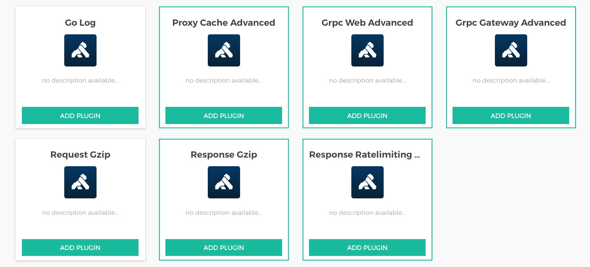](https://gitee.com/kelvins-io)   
**proxy-cache-advanced**
支持回源逻辑异步在queue处理，支持配置防缓存穿透开关+redis-lock策略+resty-lock本地策略
插件存储策略选择
[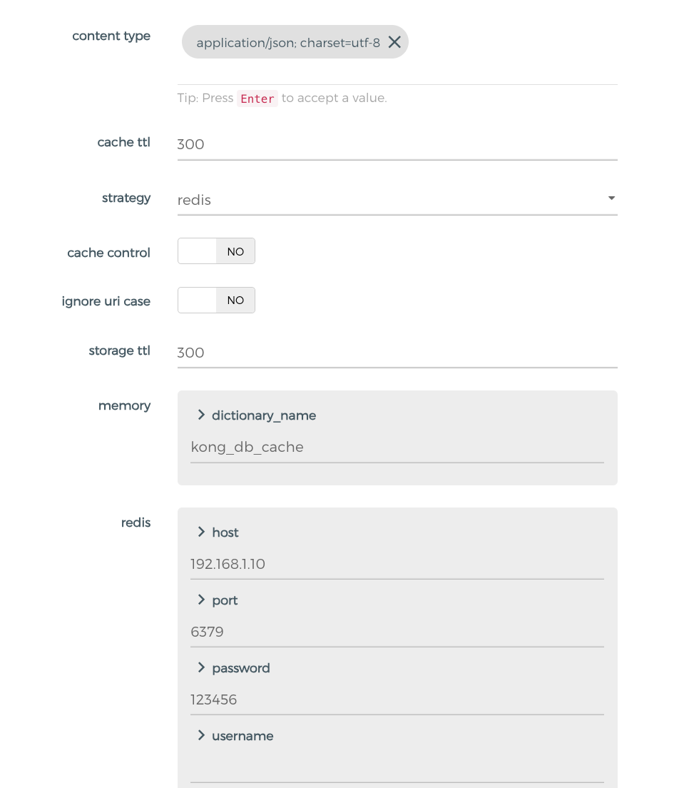]()
postman测试Redis策略
[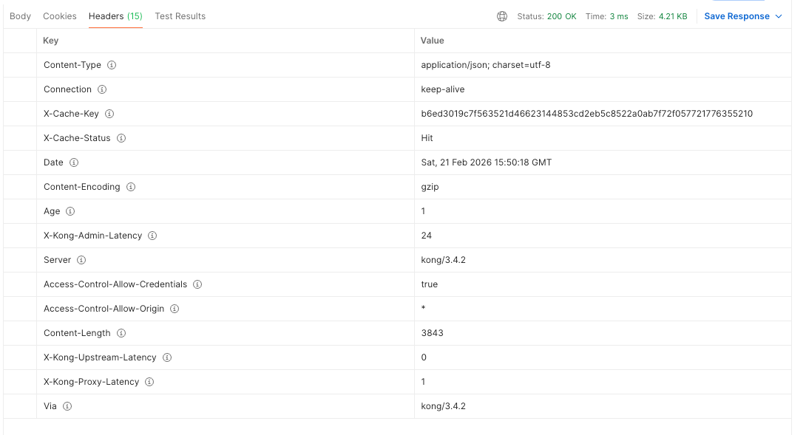]()
redis-gui查看cache-key:result
[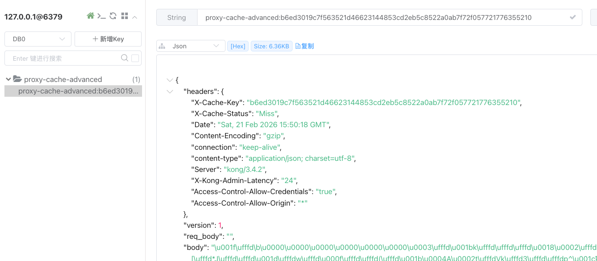]()
redis缓存key分片存储效果
[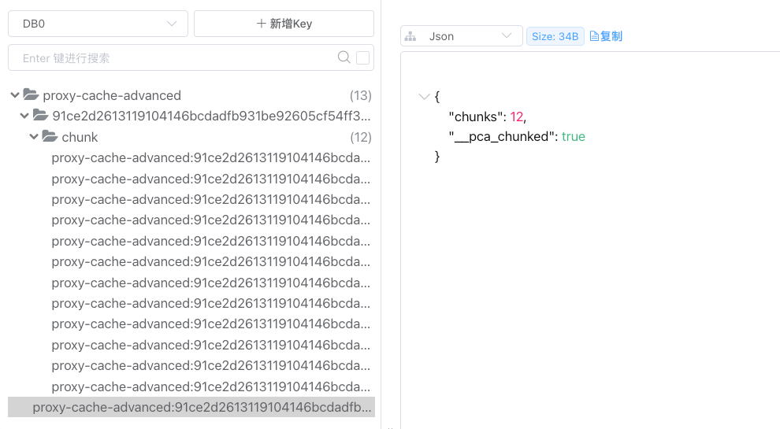]()
插件API操作cache
[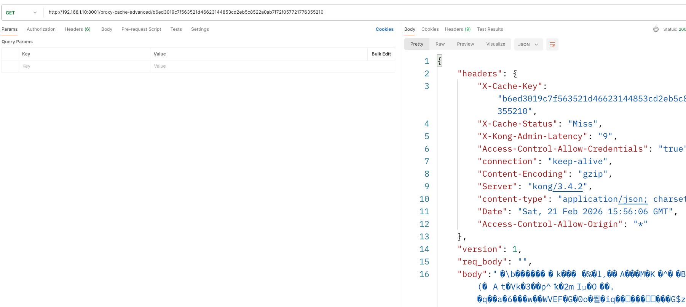]()
llm prompt缓存设置
[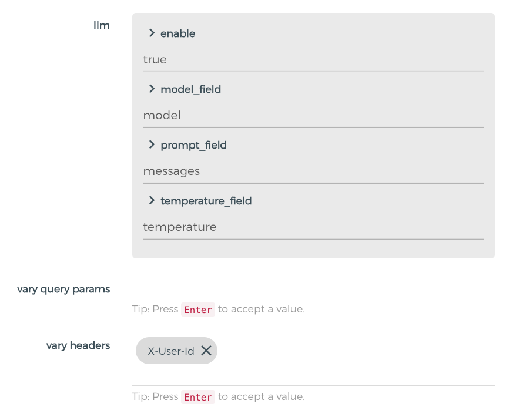]()
llm prompt缓存postman
[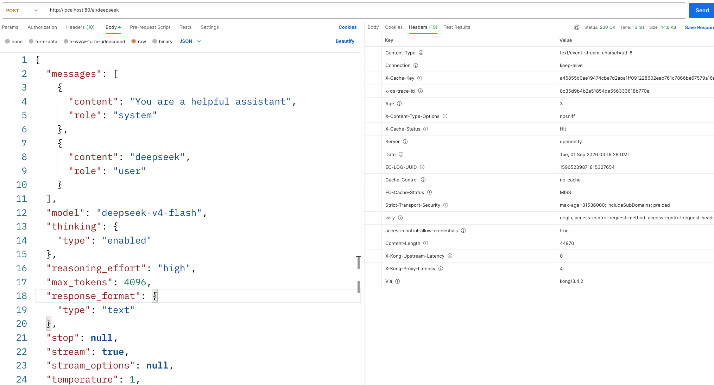]()
response-ratelimiting-advanced 搭配proxy-cache-advanced使用 postman
[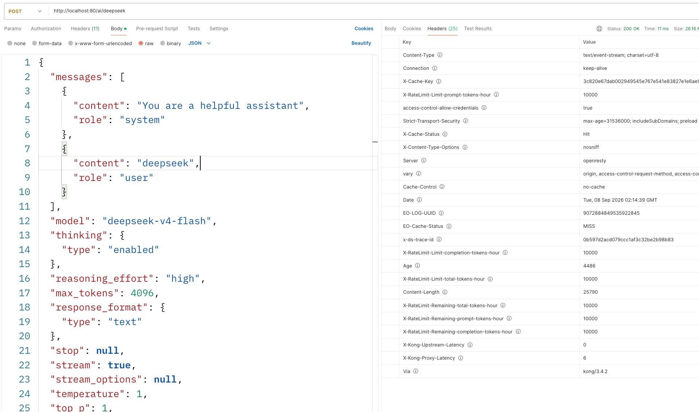]()
**grpc-web-advanced**   
proto 文件支持配置http|https文件地址和本地目录文件   
proto_cache_dir proto缓存目录（若proto为远程文件则下载后缓存到该目录下）   
[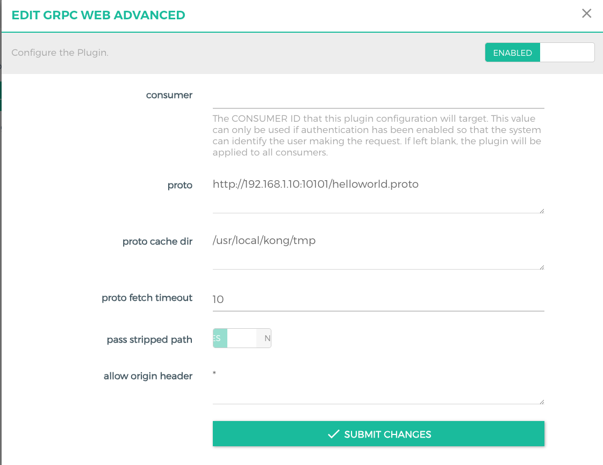]()

http-->grpc接入   
[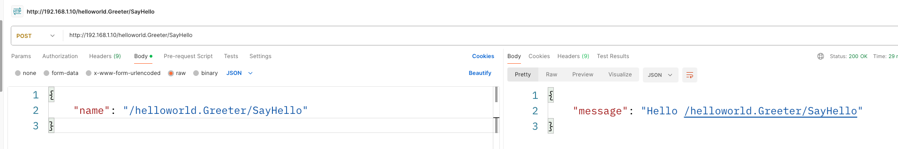]()
## 交流合作
1225807604@qq.com，flyingfish_vvip（wechat）
